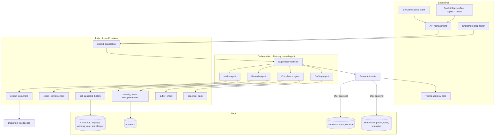

# UC1 Solution Architecture (Draft)

> Deliverable 1, Phase 1 draft. Covers context, permit checklists, layered architecture, data flow, agent design and orchestration choice, tool catalogue, data design, security summary, deployment view and decision records. Sections marked **TBD** are filled in during the build.

Related: [[UC1 Assumption Log]] · [[UC1 Security and Responsible AI Pack (Draft)]] · [[UC1 - Permit and NOC Processing Agent]]

---

## 1. Context
- **Problem:** permit/NOC review is manual, inconsistent and weakly documented (P1–P5 in the brief).
- **Solution:** a supervisor-plus-specialists agent system that turns an application pack into a **cited, auditable draft decision or RFI**, reviewed and approved by an officer in Teams.
- **Hard boundary:** agents read, analyse and draft. Only Power Automate, after a recorded human approval, changes anything outside the system.
- **In scope:** PT-1 (Environmental NOC), PT-2 (Groundwater well drilling permit). All rules, data and thresholds are fictional (see [[UC1 Assumption Log]]).

## 2. Users and departments
| Persona | Department | Main surface |
|---|---|---|
| Applicant | External (no tenant identity) | Simulated portal API; email |
| Intake officer | Air and Industrial / Groundwater (A-11) | Officer copilot (Teams) |
| Technical reviewer | Same | Officer copilot, approval card |
| Section head | Same | Approval card (high-risk cases) |
| Policy and legal owner | Cross-department | Rule admin page (SharePoint library + re-index) |
| Platform and security owner | Platform | Azure portal, dashboards |

## 3. Language pair
- **Working language:** English. **Secondary language:** Arabic (A-06, open).
- What it touches:
  - **OCR and extraction:** Document Intelligence on Arabic and mixed-language pages.
  - **Retrieval:** language field on every chunk; per-language analyzer for the keyword half of hybrid search; multilingual embeddings for the vector half.
  - **Output:** RFI and decision letter templates in both languages; the Arabic template is right-to-left.
  - **Evaluation:** extraction and retrieval metrics reported separately per language (FR-1.20).

---

## 4. Permit checklists
Source: Appendix A.1 document list and seeded defects. Validation rules are working assumptions (A-13). Key fields follow the brief's extraction measure: applicant, site, coordinates, quantities, dates.

### 4.1 Common items (PT-1 and PT-2)
| # | Document | Key fields to extract | Validation rules | Seeded defect it catches |
|---|---|---|---|---|
| C1 | Application form | Applicant name, applicant ID, permit type, site address, site coordinates, activity description, declared quantities, submission date, signature present | Required fields present; date valid; coordinates within the Authority's bounding box; **signature present** | Missing signature |
| C2 | Site plan | Site coordinates, plot ID, scale | Coordinates match C1 within tolerance (e.g. 50 m) | Mismatched coordinates |
| C3 | Trade licence copy | Licence number, holder name, issue date, **expiry date** | Holder name matches applicant; **expiry ≥ application date**; licence exists in registry | Expired licence |
| C4 | Ownership evidence | Owner name, plot ID, document date | Plot ID matches C2; owner = applicant, or authorisation present | Ownership mismatch |

### 4.2 PT-1: Environmental NOC (development or industrial activity)
| # | Document | Key fields | Validation rules | Seeded defect |
|---|---|---|---|---|
| P1-1 | Emissions or waste summary | Pollutant/waste types, annual quantities, units, control measures | Quantities consistent with C1 declared quantities; units valid | Inconsistent quantities |

### 4.3 PT-2: Groundwater well drilling permit
| # | Document | Key fields | Validation rules | Seeded defect |
|---|---|---|---|---|
| P2-1 | Well design | Well depth, diameter, casing, planned abstraction volume, well coordinates | Coordinates match C1/C2; abstraction volume consistent with C1 | Inconsistent quantities / coordinates |
| P2-2 | Hydrogeological survey | Survey date, aquifer, water level, surveyor | **Present**; survey date within a fictional validity window | Missing survey |

### 4.4 Cross-cutting checks
- **Scan quality:** pages below an OCR confidence floor are marked "invalid: illegible" and named in the RFI (seeded low-quality scan).
- **Language:** a secondary-language-only document is processed, not rejected (seeded case).
- **Hostile content:** document text never changes the verdict; suspected injection is logged and flagged (seeded hostile pack, A4).

### 4.5 Completeness verdict format
Each checklist item gets `present | missing | invalid` with a reason and the source page/region. The pack is **complete** only if every required item is `present`. Otherwise an RFI is drafted and the run **stops for officer review** (to-be step 3).

---

## 5. Layered architecture
| Layer | Components | Notes |
|---|---|---|
| Experience | Copilot Studio officer copilot (Teams), Teams adaptive approval cards, simulated portal (REST via APIM), SharePoint drop folder, SharePoint rule library as admin page | Admin page = SharePoint library + "re-index" flow + index health view (FR-1.18, Should) |
| Orchestration | Microsoft Agent Framework (Python) workflow: supervisor + 4 specialists, deployed as a **Foundry hosted agent** (fallback: Azure Container Apps); Power Automate flows | See section 7 |
| Tools and actions | Azure Functions (OpenAPI) behind API Management; Document Intelligence; rules engine; risk scoring; pack/letter generator | Read tools vs write tools separated (section 8) |
| Knowledge and data | Azure AI Search (`rules-*`, `precedents-*`); Azure SQL (registry + working store + audit ledger); Dataverse (case, decision); SharePoint (packs, rules, templates, archive) | Section 9 |
| Models | Azure OpenAI chat (two tiers) + embeddings; Content Safety + Prompt Shields | A-09 |
| Security and operations | Entra ID (OBO, managed identities, department groups), Key Vault, private endpoints (hardening phase), Purview labels, App Insights + Log Analytics + alerts, Bicep/Terraform, GitHub Actions, Power Platform solution | Section 10 |

### Component diagram


---

## 6. Data flow (happy path, A1)
```mermaid
sequenceDiagram
  participant AP as Applicant (portal)
  participant API as submit_application
  participant SUP as Supervisor
  participant INT as Intake
  participant REC as Records
  participant CMP as Compliance
  participant DRF as Drafting
  participant PA as Power Automate
  participant OFF as Officer (Teams)
  AP->>API: pack + metadata
  API->>API: create case (Dataverse), audit entry, store pack (SharePoint)
  API->>SUP: start run(case_id)
  SUP->>INT: classify, extract, validate, completeness
  INT-->>SUP: verdict = complete
  SUP->>REC: applicant/site/licence/precedents
  SUP->>CMP: assess requirements (current clauses only)
  CMP-->>SUP: findings + citations + quotes (verified)
  SUP->>SUP: risk tier + routing
  SUP->>DRF: decision pack draft
  SUP->>PA: review request (case_id, tier, reviewer level)
  PA->>OFF: approval card + copilot link
  OFF->>PA: approve / edit / reject + reason
  PA->>PA: write decision (Dataverse), send letter, archive, audit
```
- **Incomplete path (A2):** Intake → RFI draft → review request → officer approves → Power Automate sends RFI; case status "awaiting information".
- **Failure path (A8):** any tool failure after retries → case goes to the **human work queue** with full context; no partial decision.

---

## 7. Orchestration choice and reasons

### Choice
**Microsoft Agent Framework (Python), using a deterministic workflow for the main pipeline, with LLM agents inside each step.** The supervisor is a workflow with explicit states (intake → records → compliance → risk → drafting → review). It uses LLM reasoning only where judgement is needed: re-planning after failure, choosing whether to escalate, and answering officers' "why" questions.

Deployed as a **Foundry hosted agent** (containerised code; Foundry manages runtime, scaling and identity). Foundry also provides model deployments, tracing and evaluations.

### Why
| Requirement | How this choice serves it |
|---|---|
| Consistency ≥ 95% same verdict across runs | Fixed step order and structured outputs; LLM freedom limited to inside steps |
| Auditable, replayable (FR-1.19) | Each workflow step = one audit record; state is explicit |
| Reasoning, planning and tool use visible in traces (3.8) | Agent Framework + Foundry tracing; supervisor decisions logged |
| Orchestrator cannot call write tools; step budget and loop limit (3.8) | Supervisor's tool list has **no write tools**; workflow has max steps and max retries |
| RFI stops for officer review (step 3) | Workflow branch ends the run and hands off to Power Automate |
| Performance: completeness ≤ 90 s p95; full pack ≤ 5 min | Records and compliance can run **in parallel** after intake; no open-ended agent loops |
| Cost (3.14) | Smaller model for intake checks; larger model only for compliance and drafting |

### Alternatives considered
| Option | Why not chosen |
|---|---|
| Fully autonomous planner (LLM decides every step) | Lower reproducibility and harder to audit; nothing in the process needs open-ended planning |
| Single agent with all tools | Breaks least privilege: one identity would hold read, retrieval and generation rights |
| Semantic Kernel | Agent Framework is Microsoft's recommended successor that combines SK and AutoGen; same Azure integration |
| Copilot Studio as orchestrator | Too little control over step budgets, parallelism and evaluation gates; kept for the officer experience |

> [!warning] To verify in the build
> Hosted-agent availability and limits in the chosen region. Fallback: run the same Agent Framework code in Azure Container Apps with managed identity, still using Foundry for models, tracing and evals. Record the result as a decision.

---

## 8. Agents and tools

### Agent roster (from 3.8, with design detail)
| Agent | Model tier | Tools | Guardrails as implemented |
|---|---|---|---|
| Supervisor | Large (only for re-plan/escalation text) | Other agents; `get_case_state` | No write tools; max 12 steps, max 2 retries per tool; failure → work queue |
| Intake | Small | `extract_document`, `check_completeness`, SharePoint read | Document text passed as **data** in a delimited field; Prompt Shields on every document; output schema validated |
| Records | None or small (formatting only) | `get_applicant_history`, `find_precedents`, Dataverse read | Read-only SQL views; returns only case-relevant fields; PII minimised before any model call |
| Compliance | Large | `search_rules` (date/version filter enforced **in the tool**, not by the prompt), `buffer_check` | Must cite; quote verification; abstain with "cannot determine" when no supporting passage |
| Drafting | Large | `generate_pack` | Writes a draft file only; no send/issue tool exists for it |
| Workflow (Power Automate) | n/a | Dataverse write, email, Teams, SharePoint | Triggered only by a recorded approval event |

### Tool catalogue (OpenAPI; read vs write)
| Tool | Type | Reads/Writes | Identity used | Notes |
|---|---|---|---|---|
| `submit_application` | Function via APIM | Writes case + audit | Function managed identity | Idempotency key per submission |
| `extract_document` | Function wrapping Document Intelligence | Read | Managed identity | Returns fields with confidence + page/bounding region |
| `check_completeness` | Function (rules engine) | Read | Managed identity | Pure rules on extracted fields; checklist from config |
| `search_rules` | Function → AI Search | Read | Managed identity | Filter: `permit_types/any(p: p eq '{type}') and effective_from le {date} and (effective_to eq null or effective_to gt {date})` |
| `find_precedents` | Function → AI Search | Read | Managed identity | Results labelled "context, not rule" |
| `get_applicant_history` | Function → Azure SQL views | Read | **Officer identity via OBO** for department check, managed identity for SQL | Parameterised queries only |
| `buffer_check` | Function (stub) | Read | Managed identity | A-18 |
| `generate_pack` | Function | Writes draft file to SharePoint "drafts" | Managed identity | Word/PDF template render; every finding links to evidence |
| `record_decision` | Power Automate | Writes Dataverse + sends letter | Flow connection | Runs only after approval event |
| `get_case_summary`, `get_finding_evidence`, `submit_review` | Functions for the copilot (custom connector) | Read / write review request | **Officer identity (OBO)** | Department-scoped; `submit_review` only creates an approval request, it doesn't decide |

---

## 9. Data design

### 9.1 AI Search index `rules-{env}` (clause-level chunks)
| Field | Type | Purpose |
|---|---|---|
| `id` | key | `{doc_id}-{version}-{clause_id}` |
| `doc_id`, `doc_title`, `article`, `clause_id` | string, filterable | Citation |
| `version`, `effective_from`, `effective_to`, `status` | string / date | In-force filter (A-12), freshness |
| `language` | string, filterable | Per-language retrieval and metrics |
| `permit_types` | collection, filterable | PT-1 / PT-2 / both |
| `text` | searchable, per-language analyzer | Keyword half of hybrid search; quote verification |
| `text_vector` | vector | Vector half |
| `source_path`, `page` | string / int | Link back to SharePoint |
- Semantic ranker configuration on `text`, with `doc_title` and `article` as title fields.
- **Index freshness:** `indexed_at` per document; health view lists documents whose SharePoint version is newer than the indexed one.
- `precedents-{env}`: decision summary, permit type, outcome, key factors, date. Never cited as a rule.

### 9.2 Azure SQL
| Schema | Tables / views | Access |
|---|---|---|
| `registry` | applicants, sites, licences, prior_decisions, open_cases | Agents see only **read-only views** (`v_applicant_history`, `v_site_licences`) |
| `work` | case_runs, extracted_fields, completeness_items, findings, citations, risk_scores, drafts, work_queue, feedback | Written by the workflow runtime identity |
| `audit` | `agent_steps` as an **append-only ledger table** | Insert-only; replay source (FR-1.19) |

Audit record per step: case_id, run_id, step, agent, prompt_version, model + version, inputs hash, retrieved chunk IDs, tool calls (name, args, result hash), output, Prompt Shields result, latency, tokens, cost, user action (identity, time, reason).

### 9.3 Dataverse (A-04, A-15)
- `permit_case`: case ID, permit type, department, status, risk tier, assigned reviewer, links to SharePoint pack and draft.
- `review_decision`: outcome, approver, timestamp, reason, edited findings, letter link.
- Written by the intake API (case creation) and by Power Automate (decisions). Agents only read.

### 9.4 SharePoint
- `Applications/{department}/{case_id}/`: original pack (sensitivity label applied).
- `Rules/`: rule corpus library with version metadata (policy owner publishes here).
- `Templates/`: decision pack and RFI templates (EN, AR).
- `Drafts/` and `Archive/`.

---

## 10. Security architecture (summary)
Full detail in [[UC1 Security and Responsible AI Pack (Draft)]].
- **Identity:** officers sign in with Entra ID. The copilot passes the officer token to tools (OAuth on-behalf-of); tools check the officer's department group. Services use managed identities. No keys in code; remaining secrets in Key Vault.
- **Least privilege:** separate managed identities for intake API, agent runtime and Power Automate connections. The agent runtime has no Dataverse write role.
- **Untrusted content:** Prompt Shields on documents and prompts; documents passed as delimited data; output schema validation before any side-effect tool.
- **Network:** private endpoints for AI Search, SQL, Storage/Key Vault and Azure OpenAI in the hardening phase (cost), shown in the deployment view.
- **PII:** applicant identifiers masked in logs and traces; only fields needed for a finding are sent to the model.

---

## 11. Deployment view (dev)
| Resource | Purpose | IaC |
|---|---|---|
| Resource group `rg-permits-dev` | Container | Bicep/Terraform |
| Foundry project + model deployments (chat small, chat large, embeddings) | Models, hosted agent, tracing, evals | Yes |
| Azure AI Search (tier with semantic ranker) | Rules, precedents | Yes |
| Document Intelligence | Extraction | Yes |
| Azure SQL Database | Registry, working store, audit ledger | Yes |
| Function App (Python) | Tools | Yes |
| API Management (Consumption/Developer tier) | Portal API, tool front door | Yes (hardening) |
| Key Vault, App Insights, Log Analytics | Secrets, telemetry | Yes |
| Content Safety | Filters, Prompt Shields | Yes |
| Power Platform dev environment: Dataverse tables, flows, Copilot Studio agent | Experience + workflow | Power Platform solution export |
| M365: SharePoint site, Teams, test users and groups | Experience | Script / documented manual steps |

CI/CD: GitHub Actions running unit and contract tests, then the **evaluation gate** (Foundry evaluations on the regression set), then infrastructure and Functions deploy. Power Platform solution exported to the repo.

---

## 12. Decision records
| # | Decision | Reason | Status |
|---|---|---|---|
| D-01 | Deterministic workflow + LLM steps (Agent Framework) | Section 7 | Proposed |
| D-02 | Foundry hosted agent (fallback Container Apps) | Brief's target platform; managed identity and tracing | To verify |
| D-03 | In-force filter enforced in the tool, not the prompt | Stale citations are a top risk (3.14); filters can't be talked around | Proposed |
| D-04 | Quote verification by exact substring in the cited chunk | 3.9 requirement; cheap and strict | Proposed |
| D-05 | Rules engine (code) for completeness; LLM only for classification fallback and RFI wording | Accuracy targets ≥ 95%; reproducible | Proposed |
| D-06 | Two model tiers | Cost risk (3.14) | Proposed |
| D-07 | Append-only ledger table for audit | Immutable, queryable (BR-1.5) | Proposed |
| D-08 | Custom Dataverse tables instead of Dynamics 365 app | A-04 | Proposed |

## 13. What I chose not to build (so far)
- Applicant-facing status assistant (FR-1.21, Could), until Musts and Shoulds are done.
- Real GIS (out of scope; `buffer_check` stub).
- Multi-environment (test/prod) pipeline beyond parameterised IaC; described in the roadmap.
- **TBD** as the build progresses.

## 14. TBD during build
- Exact model versions and region (A-08, A-09)
- Prompt designs and versioning (deliverable 5)
- Measured latency, throughput, cost per application
- Load-test results (20 concurrent) and the 10× scaling path
